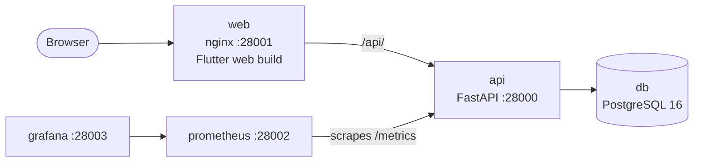
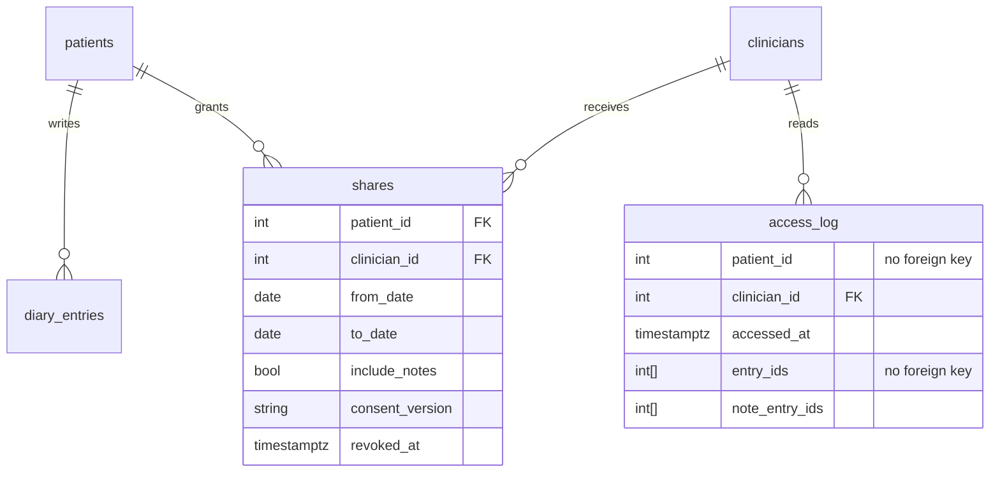
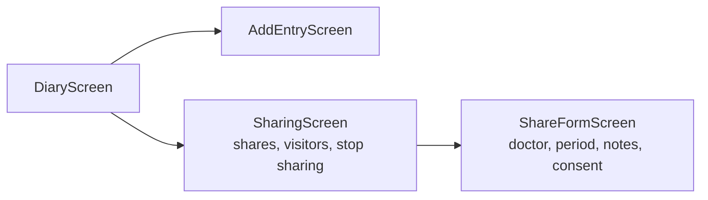

# Architecture

How the diary and diary sharing fit together. The contract is in [API.md](API.md), the rules
behind it in [REQUIREMENTS.md](REQUIREMENTS.md), and the decisions and assumptions in
[NOTES.md](NOTES.md).

## Runtime

Everything runs in Docker Compose ([docker-compose.yml](docker-compose.yml)), driven by `make`.

- **web** serves the Flutter build from `app/build/web` and proxies `/api/` to the API, so the app
  and API share an origin ([app/nginx.conf](app/nginx.conf)).
- **api** runs `alembic upgrade head`, seeds demo data, then starts uvicorn
  ([backend/Dockerfile](backend/Dockerfile)). A restart applies new migrations.
- **db** holds `diary` and a separate `diary_test` for `make test` ([db/init.sql](db/init.sql)).
- **prometheus** and **grafana** start only with `make observe`; dashboards and alert rules are
  provisioned from [observability/](observability/).

Authentication is a stub: `Authorization: Bearer <role>-<id>` resolves to a patient or clinician
row ([backend/app/auth.py](backend/app/auth.py)). The app always sends `patient-1`.

## Backend

| Module | Responsibility |
| --- | --- |
| [main.py](backend/app/main.py) | App, request logging and metrics middleware, catch-all 500 |
| [api.py](backend/app/api.py) | All routes; thin handlers over the modules below |
| [sharing.py](backend/app/sharing.py) | Pure rules: local days, `app-v1` time fix, which entries and notes a doctor sees |
| [audit.py](backend/app/audit.py) | Adds an access record to the caller's transaction |
| [models.py](backend/app/models.py) / [schemas.py](backend/app/schemas.py) | Tables / request and response shapes |
| [metrics.py](backend/app/metrics.py) | Prometheus counters and histograms |

`sharing.py` has no database or HTTP, so the rules that carry the most risk are tested directly
([test_sharing_rules.py](backend/tests/test_sharing_rules.py)).

### Data model

- **shares** is one consent: a doctor, an inclusive range of the patient's local days,
  `include_notes`, the `consent_version` the patient agreed to, and `revoked_at`. Revoking sets
  `revoked_at` once; rows are never deleted, so the consent history stays intact.
- **access_log** is one row per doctor read, listing the entries and the entries whose note was
  shown. A trigger rejects UPDATE and DELETE ([0002_sharing.py](backend/alembic/versions/0002_sharing.py)).
  It has no foreign keys to the patient or entries, so a future erasure is neither blocked by nor
  cascades into the ten-year audit trail.
- **diary_entries** and the `/entries` and `/me` responses are unchanged: app v2.3 parses them
  strictly. Doctors get their own schema, `ClinicianEntryOut`.

### A doctor's read

`GET /clinician/patients/{patient_id}/entries`, in one transaction:

1. Load this doctor's **unrevoked** shares for the patient, on every request (no caching), so a
   revocation applies to the next read.
2. None found: `404`. The same answer for "not a patient", "never shared" and "revoked", so the
   response never reveals who is a patient.
3. Work out each entry's real moment and local day in the patient's time zone. `app-v1` entries
   were stored with local wall-clock time as if UTC, so their clock time is reread as local.
4. Keep entries on a day covered by an active share. Show `note` only if a covering share has
   `include_notes`; otherwise `null`.
5. Write the access record and commit. If that write fails, roll back and return `500`: no record,
   no data. The `audit_failed` outcome is counted and pages on-call.

Every read is counted in `clinician_reads_total` by outcome (`ok`, `not_found`, `error`,
`audit_failed`).

### Logs, metrics and errors

- Logs carry method, **route template**, status and duration only: no paths with IDs, bodies or
  client IPs. Uvicorn's own access log is disabled for this reason.
- Metric labels are route templates, outcomes and event names; never patient data.
- Unhandled exceptions become `{"detail": "Internal server error"}`; only the exception type is
  logged, because database errors include SQL parameters.

## App

Flutter, built for the web, following [app/DESIGN.md](app/DESIGN.md).

- [api.dart](app/lib/api.dart): one `ApiClient` for every call, plus `track()` for best-effort
  product events (name only) to `POST /telemetry`.
- [sharing_rules.dart](app/lib/sharing_rules.dart): period presets, the consent wording and its
  `consentVersion`, which must match `CONSENT_VERSION` in the backend.
- Screens hold their own state; there is no state management library.

## Observability

| Signal | Source | Use |
| --- | --- | --- |
| `app_events_total{event}` | app `track()`: `entry_created`, `sharing_opened`, `share_created`, `share_revoked` | Product: do patients share and keep logging |
| `shares_created_total`, `shares_revoked_total` | backend | Product: sharing adoption and churn |
| `clinician_reads_total{outcome}` | backend | On-call: can doctors open diaries |
| `http_request_duration_seconds` | middleware | On-call: latency per route |

Alerts in [sharing-alerts.yml](observability/grafana/alerting/sharing-alerts.yml): any
`audit_failed` read pages; more than 5% failed doctor reads for 2 minutes pages; slow doctor reads
go to the team channel the next morning. What to watch and when to act is in NOTES.md.
