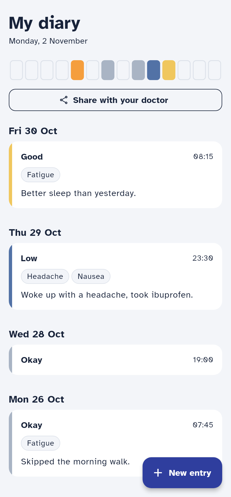
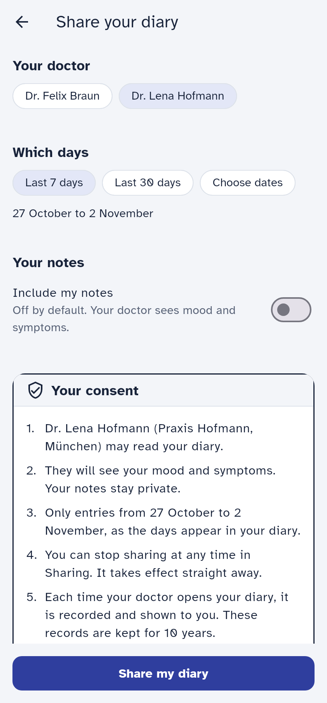
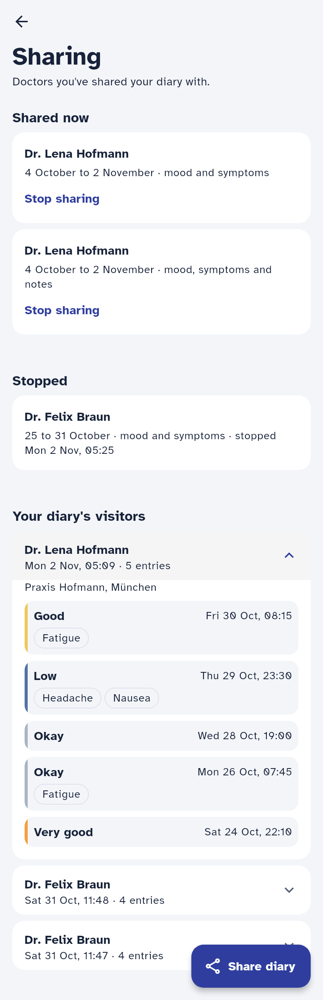
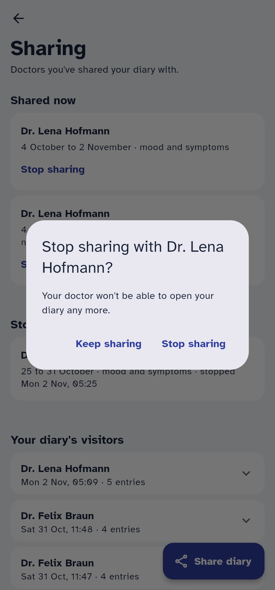
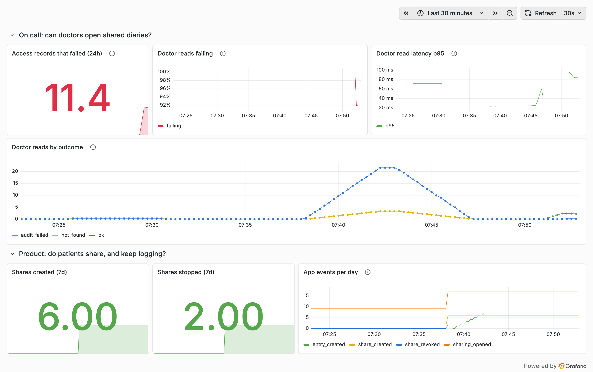
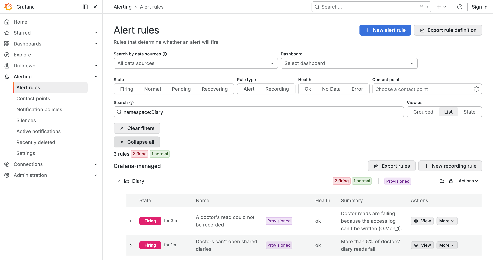

# Notes

Time spent: 2 hours. AI tools used: Claude Code. Repo context in CLAUDE.md, system overview in
[ARCHITECTURE.md](ARCHITECTURE.md).

## What I built

- **Backend:** `POST /shares`, `GET /shares`, `POST /shares/{id}/revoke`, `GET /access-log`,
  `GET /clinician/patients/{patient_id}/entries`.
- **App:** share screen, revoke, who-viewed list.
- **Observability:** 1 product signal (shares created and stopped, app events), 1 on-call signal
  (doctor reads by outcome, with three alerts). See Monitoring.
- **Not done:** erasure (out of scope; approach under Erasure) and the items in Known gaps.
- **Tests:** `make test` passes: 56 backend, 30 app.

## How to check it

```sh
make up        # app on localhost:28001, API docs on localhost:28000/docs
make observe   # Prometheus on 28002, Grafana on 28003 ("Diary sharing" dashboard)

# Patient 1 shares with doctor 1 (or use "Share with your doctor" in the app):
curl -s localhost:28000/shares -H 'Authorization: Bearer patient-1' -H 'Content-Type: application/json' \
  -d '{"clinician_id": 1, "from_date": "2026-10-01", "to_date": "2026-11-30"}'

# The doctor reads it: mood and symptoms, notes null:
curl -s localhost:28000/clinician/patients/1/entries -H 'Authorization: Bearer clinician-1'

# A real patient with no share (2) and nobody at all (999) get the identical answer:
curl -s localhost:28000/clinician/patients/2/entries -H 'Authorization: Bearer clinician-1'
curl -s localhost:28000/clinician/patients/999/entries -H 'Authorization: Bearer clinician-1'
```

The first read then appears in the app under Sharing, "Your diary's visitors".

## Assumptions and open questions

### API behaviour

- **What counts as invalid input (`422`):** an unknown `clinician_id`, or `from_date` after
  `to_date`. A single-day share is allowed. (API.md only says invalid input returns `422`.)
- **Revoking twice** returns `200` and keeps the first `revoked_at`.
- **Revoking a share that doesn't exist, or belongs to someone else,** returns the same `404`.
- **A patient calling the doctor endpoint** gets `403`. Neither API.md nor the README says this.
- **A doctor with a share but nothing in its period** gets `200` and an empty list, not `404`.
- **`GET /shares` includes revoked shares.** I read "the patient's shares" as all of them. The app
  splits them into "Shared now" and "Stopped".

### Consent and shares

- **Shares never expire.** They stay readable until revoked; API.md has no field for an end.
- **Several shares with the same doctor are allowed**, and their periods may overlap. Share dates
  may be in the future.
- **Overlapping shares and notes:** a note shows if any active share covering that entry's day
  includes notes. (Notes hidden by default is from API.md and the brief.)
- **The server stamps `consent_version`** and assumes the app showed that wording, because the
  request body is fixed.

### Time

- **`app-v1` correction:** the stored clock time is read as local time in `patients.timezone`.
  - In the hour that repeats when summer time ends, the earlier moment is used.
  - In the hour skipped when summer time starts, the winter offset is used, so the entry lands an
    hour later on the same day.
- **The phone's time zone matches `patients.timezone`**, so presets like "Last 7 days" line up with
  the server's days.
- **The patient's `/entries` keeps showing `app-v1` rows shifted.** That `/entries` can't change is
  Tom's constraint. Accepting the shift instead of migrating the data is my decision (see Known
  gaps).

### Audit

- **What counts as a read** (the brief says every read is recorded): a read that returns no
  entries still counts, because the doctor opened the diary. A refused `404` doesn't, because
  nothing was disclosed.
- **What a record holds:** entry ids and which notes were shown, no diary content. (How the table
  is built is under Data model decisions.)
- **Production permissions:** the API's database user would have only INSERT and SELECT on
  `access_log`. Allowing TRUNCATE for the test fixture is acceptable here.
- **Ten-year retention** is Selin's rule. Stating it in the consent text, and leaving the storage
  that enforces it outside this repo, are my choices.

### Privacy and monitoring

- **Where the line falls** (Selin sets the principle): route templates, status codes, durations
  and outcome labels are safe to log and measure. Raw paths, request bodies and exception messages
  aren't.
- **The clinician-read metric counts only authenticated clinician requests.** `401` and `403` stay
  in the generic HTTP metrics.
- **"Do sharers keep logging?"** is answered by a database query, not by metrics.
- **Scale:** filtering a diary in Python for the doctor read is fast enough at current sizes. 

### App

- **Deleted entries** appear as "N entries no longer in your diary". The API can't delete entries
  today, so this only shows after a future erasure or a manual fix.
- **The visitors section is called "Your diary's visitors"**, not DESIGN.md's example wording.

## Data model decisions

Migration `0002` ([backend/alembic/versions/0002_sharing.py](backend/alembic/versions/0002_sharing.py)):

- **`shares`**: one row per consent: patient, doctor, inclusive `from_date`/`to_date`,
  `include_notes` (default off), `consent_version`, `created_at`, `revoked_at`. Revoking sets
  `revoked_at`; rows are never deleted, so the patient's sharing history stays complete.
- **`access_log`**: one row per doctor read: patient, doctor, `accessed_at`, `entry_ids`, and
  `note_entry_ids` (the entries whose note the doctor actually saw).
  - **No foreign keys to `patients` or `diary_entries`.** Erasing a diary must not be blocked by the
    audit trail and must not cascade into it (see Erasure).
  - **A Postgres trigger rejects every UPDATE and DELETE** (`access_log is append-only`).
  - The doctor's name is joined in when the log is read, not copied into each row.
- Share dates are calendar days as the patient sees them. Whether an entry falls inside a share is
  decided in [backend/app/sharing.py](backend/app/sharing.py):
  - in the patient's time zone (`patients.timezone`);
  - except for `source = 'app-v1'` rows, which `true_recorded_at()` corrects as described under
    Assumptions (Time). The doctor sees the real moment; the stored rows are not changed.
- All sharing tables are in one migration, `0002`, because it never left this branch. Once a
  migration has shipped, changes go into a new one.

## Requirements

| ID | Applies? | Where it is met (code, test), or why not |
| --- | --- | --- |
| O.Purp_1 | Yes | Met. Before sharing, the form shows the doctor and practice, the data shared (mood and symptoms, plus notes only if chosen) and the exact days. The patient must tick consent before the share button works, and changing any option clears the tick ([app/lib/sharing_rules.dart](app/lib/sharing_rules.dart) `consentTerms`, [app/lib/share_form_screen.dart](app/lib/share_form_screen.dart)). Tests in `share_form_test.dart`: `consent panel names the doctor, the data and the days`, `changing what is shared clears the consent tick`, `share button is disabled until a doctor is chosen and consent is ticked`. |
| O.Cons_1 | Yes | Met. A doctor gets only entries whose local day falls inside one of their own non-revoked shares, and notes only where such a share includes them ([backend/app/sharing.py](backend/app/sharing.py), unit tests in `test_sharing_rules.py`). Without a share, the doctor gets the same `404` whether or not the person exists (`test_unknown_patient_and_not_shared_look_identical`). |
| O.Cons_2 | Yes | Met. Shares are looked up on every read, with no caching, so a revocation applies to the next read (`test_revoking_takes_effect_on_the_next_read`). Revoking is idempotent and keeps the first `revoked_at`. |
| O.Cons_3 | Yes | Partly met. Every share stores `consent_version` (`2026-10-v1`; `test_share_stores_consent_version`). API.md fixes the request body, so the server stamps its current version rather than the app sending the version it showed. An outdated app would be recorded under the new wording. Fix: an optional `consent_version` request field, agreed with the portal team. |
| O.Auth_1 | Yes | **Not met: auth is a stub in this harness.** A bearer token `<role>-<id>` has no login time, so there is nothing to compare with 15 minutes. I read "before health data is disclosed" as the moment the patient creates a share, because the doctor's later reads happen without the patient. With real auth: `POST /shares` checks the session's `auth_time` and returns `401` with a re-authentication challenge if it is older than 15 minutes; the app prompts and retries. |
| O.Pass_1 | No (for this feature) | **Not met here: there are no passwords.** Auth is a stub, and sharing adds no credential. The rule belongs to the real login service: at least 12 characters and a check against a known-breached list (for example, a k-anonymity lookup against Have I Been Pwned). |
| O.Log_1 | Yes | Met. Every successful doctor read writes one `access_log` row (doctor, time, the exact `entry_ids` returned, and `note_entry_ids` for the notes it disclosed), in the same transaction as the read ([backend/app/audit.py](backend/app/audit.py); test `test_access_record_says_which_notes_were_seen`). Reads that return nothing are recorded too, because the doctor still opened the diary. Refused (404) reads are not recorded, because no health data was disclosed. Tests: `test_every_read_is_recorded_and_shown_to_the_patient`, `test_read_with_nothing_in_the_period_is_still_recorded`. |
| O.Log_2 | Yes | Met. `GET /access-log` returns the patient's own records, newest first, with the doctor's name (`test_patients_see_only_their_own_access_log`). The app shows them under "Your diary's visitors". Gap: which notes were seen is recorded (`note_entry_ids`) but not returned, because API.md fixes the response fields. Showing it to the patient needs a contract change agreed with the app team. |
| O.Log_3 | Yes | **Partly met.** Modification is blocked by a trigger in migration `0002`; test `test_access_log_rejects_update_and_delete`. The trigger only stops UPDATE and DELETE. It doesn't stop TRUNCATE, which the test fixture relies on, and here the API's database user owns the table, so it could drop the trigger. In production the API's role should have only INSERT and SELECT on `access_log`. Ten-year retention needs infrastructure this repo doesn't have: backups or WORM storage with a retention lock. |
| O.Log_4 | Yes | Met. The existing request middleware logged every request body (mood, symptoms, notes) and the raw path; it now logs only the method, route template, status and duration ([backend/app/main.py](backend/app/main.py)). uvicorn's own access log printed raw paths and client IPs, so it is switched off in code. Unhandled errors log only the exception type, because database error messages contain the SQL parameters. Tests in [backend/tests/test_hygiene.py](backend/tests/test_hygiene.py). |
| O.Mon_1 | Yes | Met in code; the alert itself is described in Monitoring. If the access record can't be written, the read is rolled back, the doctor gets a generic `500` with no data, and `clinician_reads_total{outcome="audit_failed"}` goes up (`test_no_data_when_the_access_cannot_be_recorded`). Any increase of that counter pages someone. The series only appears at its first failure, so the alert rule also fires when it has just appeared; otherwise the first failure after a restart would be missed (see Known gaps). Also tested against the running stack: with access-log writes blocked, reads returned `500` with no data and the alert fired (Monitoring, "Audit alert, tested end to end"). |
| O.Err_1 | Yes | Met. Unhandled errors return `{"detail": "Internal server error"}` with no trace, SQL or paths. They are handled in the middleware rather than in an exception handler, because Starlette re-raises after its handlers and the server would then log the full message. Test `test_unhandled_error_returns_generic_500`. |
| O.Cryp_1 | Yes | **Not met in this harness.** The diary and `access_log` sit in a local Docker Postgres volume with no encryption at rest, and Postgres has no built-in table encryption. This is a deployment control, not application code: encrypted storage or a managed database with encryption on, using a method the security officer approves. Backups and any WORM copy of `access_log` need the same. Nothing in the sharing feature stops this. |
| O.Del_1 | Yes (stretch) | **Not built, by agreement (brief, Mara).** Not designed out: `access_log` has no foreign keys to patients or entries (`test_access_log_does_not_depend_on_entries_or_patients`), so erasing a diary is not blocked by the audit trail and doesn't cascade into it. How it would work, and the conflict with ten-year retention, is under Erasure. |
| O.Doc_1 | Yes | Met by this table: every requirement in REQUIREMENTS.md is listed with whether it applies and where it is met, or why not. |

## Erasure (O.Del_1): how I would do it

Selin wants all of a patient's data removed. Dr. Keller and O.Log_3 need the record of which doctor
saw what kept for ten years. I think both can hold: erase the health data and the identity, and
keep the small amount of evidence that a disclosure happened. Whether the law allows keeping that
evidence is Selin's call, not mine, so I've written this as a recommendation for her to decide.

### What I'd do by default

The diary entries are deleted. They are the health data O.Del_1 is about.

The patient row becomes a tombstone: name and email cleared, an `erased_at` set, the id kept.
Shares still point at it, and the bare id means nothing outside our system. `email` is unique and
not nullable today, so this needs a small migration.

I wasn't sure whether to keep shares. I chose to, revoked, because they are the consent behind each
disclosure: which doctor, which days, whether notes were included, which consent wording. They
hold no diary content. Without them, an access record says a doctor looked but not why they were
allowed to.

The access log is not touched at all. It holds only ids and times, and once the entries are gone
its `entry_ids` point at nothing, so no health data is left in it. This is the part I'd defend
hardest: no audit row is ever changed, and no one needs a way past the append-only trigger.

Logs and metrics need nothing, because they never carried patient data.

### The options I'd push back on

**Deleting the access log and shares too.** I'd push back on this because it breaks O.Log_3 and
destroys exactly the evidence Dr. Keller asked for. If Selin rules that erasure wins over
retention, it needs a written legal exception and a separate database role, used only by the
erasure job, that may bypass the trigger, with every use logged.

**Anonymising audit rows in place** (removing `patient_id`). I'd reject this outright. It edits
records that are meant to be unmodifiable, and a record that no longer says whose diary was read
doesn't serve Dr. Keller either. It fails both sides.

### How it would run

1. The patient asks in the app, after re-authenticating. An `erasure_requests` row (patient id,
   requested, completed) is the durable to-do list and the proof we did it. Before confirming, the
   app offers a data export and says plainly that the record of doctors' access is kept for ten
   years.
2. Every share is revoked straight away. Doctors lose access on their next read and get the same
   `404` as for someone who was never a patient.
3. After a short cancellation window (I'd suggest 7 days; Selin to confirm), a job deletes the
   entries and writes the tombstone in one transaction. Running it twice is safe, so a crash just
   reruns it.
4. Doctors who saw the diary, found through the access log, are told through the portal that the
   patient's data was erased. They may hold copies in their own records, and the patient's request
   reaches them too.
5. Erased data lives on in backups until they age out. I'd make restores replay `erasure_requests`
   before the database goes back into service. Otherwise one restore quietly brings back every
   erased diary, and I think that's the failure most likely to be missed.

At the ten-year mark, a scheduled purge deletes access records and kept shares older than ten
years. It runs as its own database role, the only one allowed to delete, and its runs are logged.
The API's role keeps INSERT and SELECT only.

### What's already in place, and what it would need

`access_log` already has no foreign keys to patients or entries
(`test_access_log_does_not_depend_on_entries_or_patients`), so erasure isn't blocked by the audit
trail and doesn't cascade into it. The app already shows missing entries as "N entries no longer in
your diary". It would need a new endpoint outside API.md, agreed with the app and portal teams;
`/me` and `/entries` stay as they are.

It would ship with tests that no entries remain, that the access log row count is unchanged, that
the doctor gets the identical `404`, that running the job twice is safe, and that a restore followed
by a replay leaves no erased data.

Open for Selin: the default or full deletion; whether the kept ids need a sealed, restricted mapping
back to the person for legal claims; the cancellation window; and how long backups are kept.

## Monitoring

Lukas asked what I'd measure, what should wake him and what can wait, and how he'd see what's
going on. Mara asked whether sharing was worth building. I picked one signal for each, and kept
both free of patient data: every label is a route template, a status or an outcome, never an id.
`make observe` brings up Prometheus and Grafana with the "Diary sharing" dashboard and the alert
rules already loaded ([observability/](observability/)).

### On call: can doctors open shared diaries?

The signal is `clinician_reads_total{outcome}`, counted once per doctor read. The outcome is `ok`,
`not_found` (no active share), `error`, or `audit_failed` (the read was refused because the access
record couldn't be written). I chose read outcomes over generic HTTP errors because they tell
"the doctor has no share" apart from "we broke", and only the second is Lukas's problem.

What wakes someone up:

- **Any `audit_failed`, immediately.** This is O.Mon_1, and it is the one I'd never delay: no data
  leaked, because the read was rolled back, but doctors are getting errors and we can't record
  access. A Prometheus series only appears at its first increment, so `increase()` alone would miss
  the first failure after every restart. The rule also fires when the series has just appeared.
- **More than 5% of reads failing for 2 minutes** (`error` or `audit_failed`). Below that I'd
  rather not page: a single failed read at 3 a.m. with almost no traffic would be 100%.

What waits until the morning:

- **p95 read latency above 1 second for 15 minutes.** It gets worse as diaries grow, because the
  read loads the whole diary and filters in Python. The fix is filtering in SQL, not a 3 a.m. call.
- **A jump in `not_found`.** It most likely means a portal bug sending the wrong patient ids, but it
  could be someone probing ids. Worth a look in daylight. I put it on the dashboard rather than in
  an alert, because I don't know normal levels yet.

When it's on fire, the dashboard's top row answers the question in order: failed access records
in the last 24 hours, the share of reads failing, p95 latency, then reads per minute by outcome.
After that come the API logs for `/clinician/patients/{patient_id}/entries`. They show the route,
status, duration and the exception type, never the path or the message, so they are safe to
search.

### Audit alert, tested end to end

The unit test proves the code path; I also wanted to see the alert fire against the running stack.
In the dev database I added a temporary trigger that rejects every new `access_log` row, sent 12
doctor reads over a minute, then dropped the trigger. What happened:

- every read got the generic `500` with no diary data, and no access record was written (110 rows
  before and after);
- the API log showed only `Unhandled ProgrammingError on /clinician/patients/{patient_id}/entries`,
  with no SQL or error message;
- `clinician_reads_total{outcome="audit_failed"}` went to 12, the access-record alert fired within
  a minute, and the 5% alert fired after its 2 minutes;
- after the trigger was dropped, reads returned `200` again.

What it doesn't prove: no contact point is configured in this repo, so the alert reached Grafana
but no one's phone. Routing it to a real on-call channel is a next step.

### Product: do patients share, and keep logging?

For "do they share", I use `shares_created_total` and `shares_revoked_total`, plus the app events
`sharing_opened`, `share_created` and `share_revoked` through `/telemetry`. Opened versus created
is the funnel: lots of people opening Sharing and few sharing would suggest the form or the
consent text puts them off. These are weekly numbers for Mara, so nobody acts on them in the
moment; I'd review them every two weeks for the three months.

"Do sharers keep logging?" needs to follow individual patients, and that can't go into metrics
without putting patient ids in labels. So I answer it with a query on the database instead: for
each patient who shared, the number of diary entries in the four weeks before their first share
and in the four weeks after, averaged across sharers. Only the averages reach Mara, so the answer
carries no patient data. On its own it doesn't prove sharing caused anything: patients who share
before an appointment may log more anyway. I'd compare with non-sharers over the same weeks before
calling it a win.

## Screenshots

Taken from the running app as `patient-1`, in the patient's time zone (Europe/Berlin).

**The way in.** The diary's first screen gets one new button, "Share with your doctor", under the
mood strip. Nothing else on the screen changes.



**The share form.** The patient picks a doctor and the days, and notes stay off unless they turn
them on. The consent names the doctor, the data and the days, and the button works only after the
patient ticks it.



**The sharing screen.** Active and stopped shares, then every time a doctor opened the diary.
Expanding a visit shows exactly which entries that doctor saw.



**Stopping a share.** The app asks first; stopping applies to the doctor's next read.



**The "Diary sharing" dashboard** (`make observe`, Grafana on 28003). I generated a few minutes of
traffic (shares created and stopped, doctor reads, refused reads, app events), then made the
access log reject writes for one minute (see "Audit alert, tested end to end" under Monitoring).
The top row is the on-call view; the bottom row is the product view. The failed-records tile reads
11.4 for 12 failures, because `increase()` extrapolates over its window. Before any failure,
"Doctor reads failing" shows "No data" rather than 0% (see Known gaps).



**Both paging alerts firing** during that minute: the access-record alert first, the 5% failure
alert two minutes later as designed. The morning-only latency alert stayed normal.



## How I used AI

**Tools:** Claude Code in VS Code, Opus 5.5 (medium), with my own `CLAUDE.md` and custom agents, plus an additional agent for independent review. Every prompt is in [PROMPTS.md](PROMPTS.md) with a refined version and its outcome.

**Workflow**

1. **Brainstorm.** The agent read every doc and listed the traps in the brief. I set the goals:
   every trap handled visibly, honest notes, small modules with the rules in pure functions. We
   agreed the backend, then the screens as browser mockups.
2. **Plan.** Test-first tasks with exact focus area, checked against the
   timebox.
3. **Implement.** One task at a time: the agent explains its decisions, writes failing tests, then
   the code. For each change it had to say why the user needs it and how it solves their problem
   before I accepted it.
4. **Review.** A self-review, then a reviewer with no session history. I applied the fixes I had found myself and recorded the rest under Known gaps.

**Where I corrected the agent**

- It wanted `--no-access-log` in the Dockerfile. That file is dev-only, so the switch went into
  code with a test (PROMPTS 10–11).
- I asked whether returning corrected `app-v1` times to doctors was in the brief. It isn't; it is
  an inference, kept because otherwise the response contradicts its own day filter (22–23).
- It added a new migration `0003` for an unshipped table. I folded it into `0002` (25).
- It started writing tests for spacing and tap targets. Dropped; the rule is now "test
  functionality, not design" (30).
- The share form broke DESIGN.md in four places until I asked for a rule-by-rule check (29).
- Its assumptions list included things BRIEF.md and API.md already define. Trimmed (36).

## How I'd work in a production team

This take-home was built straight on `main`. In a team, with patients' health data, I would change
how the work reaches production:

- **A branch per ticket, never work on `main`.** Every feature or bug gets its own branch named
  after the ticket (for example `feat/KRA-123-diary-sharing`), and `main` is protected: no direct
  pushes, and a merge needs green CI and at least one approving review.
- **One commit per change.** Each commit does one thing and keeps the tests green, so it can be
  reviewed, reverted or bisected on its own.
- **Small PRs.** Under about 1,000 changed lines, with a short description (what changed, why, how
  to test it) and screenshots for any UI change. This feature would be several PRs: logging fix,
  sharing rules, migration, patient endpoints, doctor read, app screens, monitoring.
- **Rebase, don't merge.** Branches are rebased on `main` before merging, so the history stays
  linear and every commit on `main` is one that was reviewed.
- **CI on every PR.** Backend and app tests, linting and type checks, a migration up-and-down
  check, and the frozen-contract snapshot for `/entries`, `/me` and API.md (see Next steps).
- **Migrations ship apart from code.** Expand first, deploy, then contract. Old app versions
  (v2.3) and the running API must keep working at every step, and a shipped migration is never
  edited.
- **Release behind a feature flag.** Sharing would go out switched off, then to staff, one clinic
  and everyone, with a kill switch. The backend can roll back, but installed apps can't, so the
  API stays compatible with every app version still in use.
- **Privacy and security sign-off before release.** Selin reviews the consent text, the data shared
  and the audit retention. Dependency and secret scanning run in CI.
- **Staging uses made-up data only.** No production diary data in staging, test fixtures,
  screenshots or AI prompts.
- **Contract tests with the portal team**, run in both pipelines, so a change on either side that
  breaks API.md fails before release, not in their tests.
- **Versioned releases.** A tag per release, with a changelog generated from the Conventional
  Commits messages.

## Known gaps

An independent code review of the backend found these. I fixed only what I had found myself; the
rest are known gaps, not oversights. Each line says what is wrong, why it matters and the fix.

1. **Outcome series are not created at 0 (O.Mon_1).** Prometheus creates a labelled series only
   when it is first incremented, so `clinician_reads_total{outcome="audit_failed"}` appears already
   at 1 and `increase()` alone sees no change. The alert rule works around this by also firing when
   the series has just appeared, so the first failure after a restart does page. The cleaner fix is
   to create all four outcome series at 0 when [backend/app/metrics.py](backend/app/metrics.py)
   loads, plus a test, so the alert can be a plain `increase()`. The same gap makes the
   dashboard's "Doctor reads failing" panel show "No data" instead of 0% on a healthy day, which
   looks like broken monitoring to whoever is on call. Creating the series at 0 fixes both.
2. **Audit failure is tested at the add step only.** `test_no_data_when_the_access_cannot_be_recorded`
   makes `record_access` raise. In production the failure would come at `commit()`. The code
   handles both the same way, and I checked the database path by hand against the running stack
   (see Monitoring), but there is no automated test for it. Fix: a test where the database really
   rejects the row, for example with the same temporary trigger.
3. **Two revokes at the same moment** can both see `revoked_at IS NULL`. The second then
   overwrites the time and the revoke counter goes up twice. Fix: one conditional
   `UPDATE shares SET revoked_at = now() WHERE id = … AND patient_id = … AND revoked_at IS NULL RETURNING …`.
4. **Two 422 shapes.** Validation errors return FastAPI's list `detail`; "unknown clinician" returns
   a string. API.md only promises `422`, but the portal may parse both the same way. Fix: return
   the unknown doctor as a validation error on `clinician_id`.
5. **The uvicorn access log is switched off in code only.** That holds because uvicorn configures
   logging before importing the app. If a later logging config were applied (`--log-config`, gunicorn
   workers), the raw-path log would come back. I kept the switch in code so the rule travels with the
   app; adding `--no-access-log` to the start command as well would be a cheap second guard (see
   Next steps).
6. **Patients still see `app-v1` entries shifted.** The doctor's view uses the corrected time, but
   `/entries` can't change (app v2.3), so the patient's own diary shows those rows an hour or two
   off, sometimes on the next day. Fix: a one-off data migration of the `app-v1` rows, coordinated
   with the mobile team.

## Next steps

Grouped by who they protect. Within each group, the first item is the one I'd do first.

### Consent the patient can trust

- **Keep the exact consent text, not just its label.** A version string like `2026-10-v1` proves
  nothing if no one can show what it said. A `consent_texts` table keyed by version, served to the
  app, would let us show any patient the words they agreed to (O.Cons_3). The same change can let
  the app send the version it displayed, instead of the server assuming it.
- **Save the time zone on each share.** A share's days are read in `patients.timezone` at the
  moment of each read. If a patient moves and that changes, every old share quietly covers
  different entries than the ones they agreed to. Storing the zone when the share is created keeps
  the consent exact. I'd treat this as a gap in my design, not polish.
- **Let shares end by default.** I assumed no expiry because API.md has no field for one, but
  "share last week before my appointment" rarely means "forever". An end date, for example 30 days
  after `to_date`, would make the safe choice the default. It needs the portal team's agreement.
- **Ask for a fresh login before sharing (O.Auth_1)**, once real authentication replaces the stub.
- **Show the consent in the patient's language.** The patients are in Munich and Lisbon, and the
  terms are English only. Consent someone can't fully read is hard to call informed.

### Telling patients who looked

- **Collapse repeated visits.** Today each read is its own row, so a doctor reloading the page shows
  up several times a minute apart (see the screenshot). "Dr. Braun, 3 times on 31 October" reads
  as what it is; a list of identical rows reads as alarming.
- **Notify the patient when a doctor opens their diary.** A list they have to go and check is easy
  to miss. A notification means unexpected access is noticed the same day.
- **Show which notes a doctor saw (O.Log_2).** `note_entry_ids` is already recorded; returning it
  needs a contract change with the app team.

### Keeping the audit trail sound

- **Make the access log tamper-evident.** The trigger stops the API changing rows, but not someone
  with database admin rights. If each row also stored a hash of the row before it, any edit would
  break the chain and show up on a check (O.Log_3).
- **Give the API a database role that can only add and read access records.** Today it owns the
  table and could drop the trigger. A separate role for the ten-year purge would be the only one
  allowed to delete.
- **Build erasure** as described above, once Selin has picked between keeping the evidence and full
  deletion.

### Knowing when it breaks

- **Route the alerts to a real on-call channel.** I made the access log fail on purpose and watched
  both paging alerts fire in Grafana (see Monitoring), but no contact point is configured here, so
  nobody was actually paged. Connecting one and repeating the test closes that last step.
- **Add a synthetic doctor.** A probe that opens a dedicated test diary every minute catches the
  case our metrics can't: the portal or network down, so no requests arrive at all. It needs its
  own test patient and doctor, so it never writes into a real patient's access log.
- **Request IDs and data-scrubbing error tracking.** Logs deliberately leave out exception
  messages. A request ID in the response header, plus an error tracker that strips data, would make
  a `500` debuggable without putting health data back in the logs.
- **Check the logs in the deployment pipeline.** The uvicorn access log is switched off at import
  time; a production logging config applied later could switch it back on. The pipeline should
  fail if logs contain raw paths.

### Hardening for production

- **Turn off `/docs` and `/openapi.json` in production.** They publish the full schema and the
  FastAPI version, which is the kind of internal detail O.Err_1 is about.
- **Snapshot the frozen contract in a test.** Kranus runs their own tests against API.md, and app
  v2.3 parses `/entries` and `/me` strictly. A test that compares our OpenAPI schema for those paths
  with a stored copy would catch a renamed field before anyone else does.
- **Migrate the `app-v1` rows**, with the mobile team, so the patient's own diary shows them at the
  right time too.

### Answering Mara

- **Run the retention query**, compared with non-sharers. Report a result only when the group has
  at least about 10 patients. An average over three people is close to describing each of them.

### Scaling, only when needed

Nothing here is needed at take-home scale. I'd wait for the latency alert or a measurement before
doing each one, in roughly this order.

- **Move the day filter into SQL when diaries grow.** A doctor's read loads every entry the patient
  has and filters in Python, so its cost grows with the whole diary, not the shared period. Turning
  each share's local days into a UTC range (with the `app-v1` correction) lets the database return
  only shared entries, backed by an index on `diary_entries (patient_id, recorded_at)`. The rules
  in `sharing.py` stay as the tested reference.
- **Run more API instances, but keep consent reads on the primary.** The API holds no state, so it
  scales out behind a load balancer. The catch is O.Cons_2: a read replica that lags behind a
  revocation would let a doctor read after consent was withdrawn. The share lookup and the audit
  write stay on the primary; only the patient's own screens could move to a replica.
- **Pool database connections.** More instances means more connections. PgBouncer in front of
  PostgreSQL keeps the count bounded.
- **Partition `access_log` by month.** It only grows, for ten years, and every doctor read adds a
  row. Monthly partitions on `accessed_at` keep the patient's access-log query fast, with an index
  on `(patient_id, accessed_at)`, and make the ten-year purge a dropped partition run by the purge
  role, instead of row deletes the trigger forbids anyway.
- **Collect metrics from every worker.** `prometheus_client` counts per process. With several
  workers per pod, it needs multiprocess mode, or `audit_failed` could be counted in a process
  Prometheus never scrapes, and the page would not fire.
- **Don't cache shares.** Caching is the usual next step for a hot read, and here it's ruled out:
  consent is checked at read time (O.Cons_2). If the share lookup ever gets slow, the composite
  index `ix_shares_clinician_patient` is the lever, not a cache.

### Documenting the design

[ARCHITECTURE.md](ARCHITECTURE.md) covers the runtime, modules, data model and the doctor's read.
With more time I would:

- **Complete the ERD and add a short "Database design" section**: every table with its columns and
  keys, the `mood` check, the indexes (including `ix_shares_clinician_patient` for the doctor's
  lookup), and which rules live in the database (append-only trigger) versus the request schema
  (`from_date <= to_date`).
- **Replace the screen-navigation diagram with a user flow**: the patient shares with consent, the
  doctor reads, the patient sees the visit, then revokes and the doctor gets a 404.
- **Add a sequence diagram to the doctor's read section**: the consent check, the identical 404,
  filtering, the audit write in the same transaction, and the rollback and page when it fails.
